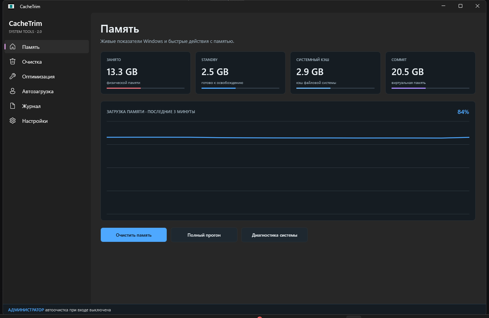
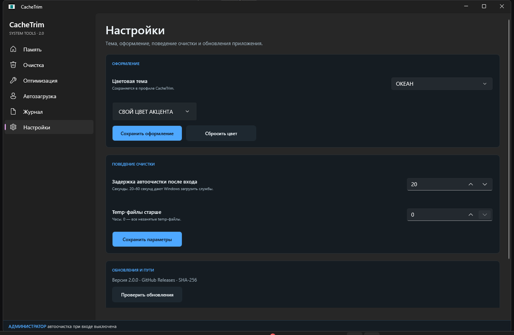

# CacheTrim 2.1.5

Основное приложение переведено с WinForms/WinUI 3 на **WPF + WPF-UI** и .NET 10.
Для запуска требуется Windows 10 версии 2004 (сборка 19041) или новее, x64.
Приложение автономное, запрашивает права администратора через UAC и поставляется
одним EXE.

Интерфейс использует [WPF-UI](https://github.com/lepoco/wpfui): боковую навигацию,
Fluent-кнопки и карточки. В настройках доступны темы Индиго, Океан, Графит и
**Жидкое стекло**. Используется системный Desktop Acrylic Windows, который размывает
содержимое за окном. Можно настроить плотность тонировки и цвет; силу размытия
определяет Windows.

Оптимизатор для Windows 11/10 в духе RAMMap: освобождает standby-список, обрезает
рабочие наборы процессов и системный кэш файловой системы, чистит temp, кэши
браузеров и шейдеров, кэш обновлений, дампы, UWP-кэши и сетевые кэши — вручную
кнопкой и автоматически при входе в систему. Плюс отдельные модули оптимизации
Windows и игр с возможностью вернуть исходные значения.

На вкладке «Расширенные» есть игровой профиль с возвратом стандартных настроек,
создание точки восстановления, сброс сети, очистка кэшей шейдеров и загрузок Windows
Update, восстановление компонентов Windows и другие системные действия. Перед
изменениями CacheTrim показывает предупреждение и просит подтверждение.





## Интерфейс

Тёмное окно, слева навигация, справа страница.

| Страница | Что там |
|---|---|
| **Память** | Четыре живых счётчика, график загрузки за последние 3 минуты, очистка памяти, полный прогон и диагностика системы |
| **Очистка** | Выбранные категории разложены по двум колонкам: память и сеть слева, файлы и кэши справа. Занятые файлы пропускаются |
| **Оптимизация** | Два модуля: 18 настроек Windows и 3 игровых настройки. Переключатели применяют настройку сразу; действия внизу применяются только к выбранному модулю |
| **Автозагрузка** | Список записей HKCU/HKLM Run, папок автозагрузки и задачи CacheTrim. Снятая галочка **прячет** запись в резерв, ничего не удаляется |
| **Журнал** | Живой лог сессии + кнопки загрузки `history.log`, открытия файла и папки |
| **Настройки** | Задержка автоочистки после входа, возраст temp-файлов, пути, тема, задача планировщика и обновления GitHub |

В настройках выбираются темы **Индиго**, **Океан** и **Графит**. Свой цвет акцента
раскрывается отдельно, чтобы не занимать место на странице. Настройки сохраняются
в профиле. Эффект захвата рабочего стола включается только в теме «Жидкое стекло».

На странице **Оптимизация** есть действия обслуживания Windows: подбор правильной
операции оптимизации для дисков, проверка защищённых системных файлов и быстрые
ссылки на игровые настройки Windows. Обслуживание дисков и SFC запрашивают
подтверждение и пишут результат в журнал.

## Обновления для друзей

Исходный код и выпуски публикуются в [GitHub-репозитории CacheTrim](https://github.com/erwwec/CacheTrim).
На странице **Настройки** нажмите **Проверить обновления**. Приложение загрузит
последний GitHub Release, сверит SHA-256, заменит EXE после закрытия и запустится
с новой версией. Для распространения достаточно один раз отправить друзьям EXE
из [последнего выпуска](https://github.com/erwwec/CacheTrim/releases/latest).

Новый выпуск владелец публикует тегом версии: обновить `Version` в
`winui/Core/AppInfo.cs`, создать коммит, поставить тег с соответствующей версией (например, `v2.1.5`) и выполнить
`git push origin main --tags`. GitHub Actions соберёт WPF-приложение на Windows,
запустит автономную публикацию и прикрепит EXE вместе с контрольной суммой.
Установку друзья запускают с запросом UAC, поскольку манифест требует прав
администратора. Выпуск — автономный файл около 85 МБ.

Скролл на страницах «Очистка» и «Автозагрузка» нарисован вручную — системный
светлый скроллбар на тёмной теме выглядит как дырка в окне.

## Что он делает

Память (те же вызовы, что у RAMMap):

| Действие | Механизм |
|---|---|
| Trim working set | `NtSetSystemInformation(SystemMemoryListInformation=0x50, MemoryEmptyWorkingSets=2)` |
| Flush modified page list | `... 0x50, MemoryFlushModifiedList=3` |
| Empty standby list | `... 0x50, MemoryPurgeStandbyList=4` |
| Empty low-priority standby | `... 0x50, MemoryPurgeLowPriorityStandbyList=5` |
| Trim system file cache | `SetSystemFileCacheSize(-1, -1, 0)` + `SeIncreaseQuotaPrivilege` |

Привилегии включаются в процессе: `SeProfileSingleProcessPrivilege`,
`SeIncreaseQuotaPrivilege`. Без прав администратора чистка памяти не выполняется —
приложение собрано с манифестом `requireAdministrator`, так что UAC спросит сразу.

Диск и кэши:

- `%LOCALAPPDATA%\Temp`, `C:\Windows\Temp`, `CrashDumps`, `INetCache`
- temp-папки других локальных профилей (только если запущено от админа)
- кэши Chrome / Edge / Brave / Vivaldi / Chromium / Yandex / Opera
  (`Cache`, `Code Cache`, `GPUCache`, `Service Worker\CacheStorage`, `DawnCache`)
- кэш шейдеров: `D3DSCache`, NVIDIA `DXCache`/`GLCache`, AMD, Intel
- эскизы проводника: `thumbcache_*.db`, `iconcache_*.db` (занятые пропускаются)
- отчёты Windows Error Reporting (`ReportQueue`, `ReportArchive`, `Temp`)
- дампы: `MEMORY.DMP`, `Minidump`, `LiveKernelReports`
- кэш Windows Update: `SoftwareDistribution\Download` и Delivery Optimization;
  на время прохода останавливаются `wuauserv` и `bits`, потом поднимаются обратно
- кэши UWP-приложений: `LocalCache` и `TempState` пакетов (до 300 за проход)
- `Prefetch` старше 7 дней (по умолчанию выключено)
- старые логи `C:\Windows\Logs` — CBS, DISM, MoSetup, WindowsUpdate, старше 7 дней
- корзина (`SHEmptyRecycleBin`, по умолчанию выключено)

Сеть:

- DNS-кэш (`DnsFlushResolverCache`)
- ARP-кэш (`netsh interface ip delete arpcache`)
- NetBIOS-кэш (`nbtstat -R`)

Занятые файлы не ломают проход: они считаются пропущенными и попадают в лог.
Ошибка любого шага — строка в логе, а не падение.

## Модули оптимизации

На странице **Оптимизация** доступны независимые модули **Windows** и **Игры**.
Переключатель применяет настройку в фоне; состояние перечитывается из системы.
Кнопки «Применить модуль» и «Вернуть по умолчанию» работают только с открытым модулем.

| Пункт | Что делает |
|---|---|
| План «Высокая производительность» | `powercfg /setactive 8c5e7fda-…`; выключение возвращает «Сбалансированный» |
| Отключить гибернацию | `powercfg /h off` — `hiberfil.sys` уходит с диска; заодно пропадает быстрый запуск |
| Отключить быстрый запуск | `HiberbootEnabled=0`: полное выключение вместо гибернации ядра |
| Отключить телеметрию (DiagTrack) | `sc config DiagTrack start= disabled` + стоп службы |
| Отключить WAP-push | `dmwappushservice` в disabled |
| Отключить SysMain (SuperFetch) | служба в disabled: standby больше не наполняется сам |
| Отключить индексацию поиска | `WSearch` в disabled, индекс не строится |
| Телеметрия в политике = 0 | `HKLM\…\DataCollection\AllowTelemetry=0` |
| Без P2P в Windows Update | `DODownloadMode=0` — только HTTP, без раздачи другим машинам |
| Визуальные эффекты: производительность | `VisualFXSetting=2` + `SystemParametersInfo(SPI_SETUIEFFECTS)` |
| Без задержки меню | `MenuShowDelay=0` вместо 400 мс |
| Без анимации окон | `MinAnimate=0` |
| Отключить прозрачность | `EnableTransparency=0` |
| Без веб-поиска в Пуске | `BingSearchEnabled=0`, `ConnectedSearchUseWeb=0` |
| Отключить виджеты | `AllowNewsAndInterests=0` |
| Без обновления last access | `NtfsDisableLastAccessUpdate=1` |
| Длинные пути (>260) | `LongPathsEnabled=1` |
| Отключить автовоспроизведение | `DisableAutoplay=1` |

Пункты, которым нужен перезаход в систему, помечены в подписи жёлтым
«нужен перезаход». Службы и план питания применяются сразу.

### Игры

| Пункт | Что делает |
|---|---|
| Включить игровой режим Windows | Включает `AutoGameModeEnabled` и `AllowAutoGameMode` для текущего пользователя |
| Отключить системный Game DVR | Отключает фоновую запись игр (`GameDVR_Enabled=0`, `AllowGameDVR=0`) |
| Отключить запись игровых клипов | Отключает фоновую запись клипов (`AppCaptureEnabled=0`); ручной оверлей остаётся доступен |

Каждый игровой параметр можно вернуть по отдельности; кнопка сброса возвращает значения
только текущего модуля.

Параметры служб перед изменением сохраняют исходный тип запуска и состояние
(работала ли служба) в `HKCU\Software\CacheTrim\TweakBackup\Services`. При возврате CacheTrim
восстанавливает их; ранее остановленные службы не запускаются самовольно.
Остальные настройки возвращают указанные в таблице стандартные значения, а не
удаляют ключи.

## Как пользоваться

1. `dist\CacheTrim.exe` — двойной клик, подтвердить UAC.
2. На странице **Очистка** выбрать галочками, что чистить, и нажать
   **СОХРАНИТЬ ГАЛОЧКИ**.
3. **ОЧИСТИТЬ ПАМЯТЬ** — только память, почём бы она ни стоила: рабочие наборы,
   standby, modified list, системный кэш ФС.
4. **ПОЛНЫЙ ПРОГОН** — всё включённое, кроме корзины.
5. **Настройки → ВКЛЮЧИТЬ АВТООЧИСТКУ** — создаёт задачу планировщика
   `CacheTrim Autostart`: триггер «при входе в систему», задержка из настроек,
   `RunLevel=HighestAvailable` (запуск от админа без повторного UAC), действие
   `CacheTrim.exe --silent`.
6. **СНЯТЬ** — удаляет задачу.

Галочки сохраняются в `%APPDATA%\CacheTrim\config.ini` и применяются и к ручной
чистке, и к автоматической.

## Автозагрузка без удаления

Снятая галочка не удаляет запись, а переносит её в резерв:

```
HKCU\Software\CacheTrim\Disabled\HKCU       ветка \Run для HKCU
HKCU\Software\CacheTrim\Disabled\HKLM       ветка \Run для HKLM
HKCU\Software\CacheTrim\Disabled\HKLM32     ветка \Run для WOW6432Node
%APPDATA%\CacheTrim\StartupBackup\<источник>  файлы из папок автозагрузки
```

Обратная галочка возвращает запись на место. Отключение и восстановление пишутся
в журнал.

## Файлы и пути

```
%APPDATA%\CacheTrim\config.ini        настройки (какие пункты чистить)
%LOCALAPPDATA%\CacheTrim\history.log  журнал запусков, в том числе ночных/стартовых
%APPDATA%\CacheTrim\StartupBackup\    резерв отключённых записей автозагрузки
HKCU\Software\CacheTrim\TweakBackup  исходные настройки служб для отката
```

Тихий режим для планировщика:

```
CacheTrim.exe --silent
```

Пишет историю и выходит с кодом 0. Код 1 — запущено без прав администратора.
Окно не показывается. Журнал обрезается по 512 КБ, чтобы не расти годами.

Служебный аргумент `--page=N` открывает приложение сразу на нужной странице
(0 — Память, 1 — Очистка, 2 — Оптимизация, 3 — Автозагрузка, 4 — Журнал,
5 — Настройки, 6 — Расширенные функции).

## Сборка

Нужен .NET 10 SDK и подключение к NuGet при первой сборке. Публикуется
автономный WPF x64 EXE, так что друзьям не нужно отдельно устанавливать .NET.

```powershell
powershell -ExecutionPolicy Bypass -File .\build.ps1
```

Результат: `dist\CacheTrim.exe` (примерно 85 МБ), манифест `app.manifest`
вшит. Запуск: двойной щелчок по `dist\CacheTrim.exe` и подтверждение UAC.
Сборка и CI используют один и тот же проект `wpf\CacheTrim.Wpf.csproj`.

## Чего ожидать по цифрам

Замер на этой машине (16 ГБ, Windows 11 26H2):

| Прогон | Мусора на диске | Доступная RAM |
|---|---|---|
| первый, холодный temp | 1.4 ГБ, 16 636 файлов | после: занято 6.3 / 15.7 ГБ, доступно 9.4 ГБ |
| второй | 759 Б, 1 файл | — |
| кнопка в GUI | 1.0 КБ, 1 файл | 9.0 → 11.0 ГБ (+2.0 ГБ за проход) |
| запуск из задачи планировщика | 2.2 КБ, 2 файла | после: занято 5.5 / 15.7 ГБ, доступно 10.2 ГБ |

Standby после чистки падает с ~1.8 ГБ до ~0.5 ГБ, системный кэш — с 1.4 ГБ до
~0.25 ГБ. Пропущенных занятых файлов стабильно ~101 (профили браузеров держат
файлы открытыми — так и должно быть).

Purge standby выкидывает и SuperFetch-кэш: сразу после запуска проводник и
браузеры открываются чуть медленнее, зато память отдана приложениям. Поэтому
автоочистка стоит с задержкой 20 секунд после входа, а не в момент логина.

## Удаление

1. В приложении **Настройки → СНЯТЬ** автоочистку.
2. На странице **Оптимизация** нажать **СТОКОВЫЕ ЗНАЧЕНИЯ**, если что-то
   включали: службы, план питания и ключи вернутся к заводским.
3. Проверить, что в автозагрузке не осталось ничего отключённого этим
   приложением, — иначе записи останутся в резерве.
4. Удалить папку с exe.
5. При желании — `%APPDATA%\CacheTrim` и `%LOCALAPPDATA%\CacheTrim`.
6. Если приложение вносило адрес в исключения Defender — убрать.

## Структура кода

```
src/Native.cs      P/Invoke: привилегии, NtSetSystemInformation, счётчики памяти
src/Cleaner.cs     один проход чистки: файлы, службы, сеть, корзина, память
src/Config.cs      INI-настройки, пути логов, Clone() для снимка настроек
src/TaskSetup.cs   регистрация/снятие задачи через schtasks + XML
src/Tweaks.cs      каталог твиков Windows и страница «Оптимизация»
src/Diagnostics.cs окно диагностики системы: версия Windows, память, commit, диск и ресурсы
src/Autostart.cs   перечисление и отключение записей автозагрузки с резервом
src/Theme.cs       палитра, шрифты, скруглённые карточки, бары
src/Controls.cs    саморисуемые кнопки, тумблеры, чекбоксы, чипы, степпер, строки
src/Nav.cs         левый рельс с нарисованными иконками
src/Pages.cs       ScrollHost и пять страниц
src/MainForm.cs    окно, роутинг страниц, прогоны, статус-бар
src/Program.cs     точка входа, режим --silent, --page=N
tools/grab.ps1     отладочный захват окна в PNG (PrintWindow)
```

Дизайн-токены, геометрия контролов и разбор каждой страницы — в `DESIGN-BRIEF.md`.

